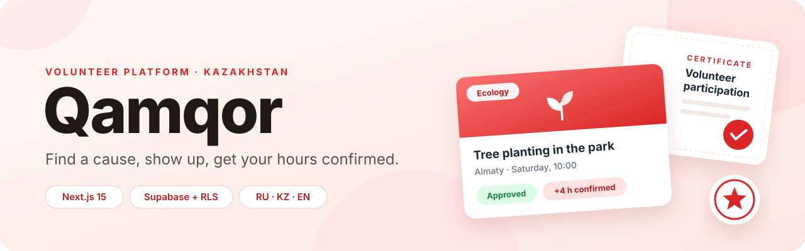
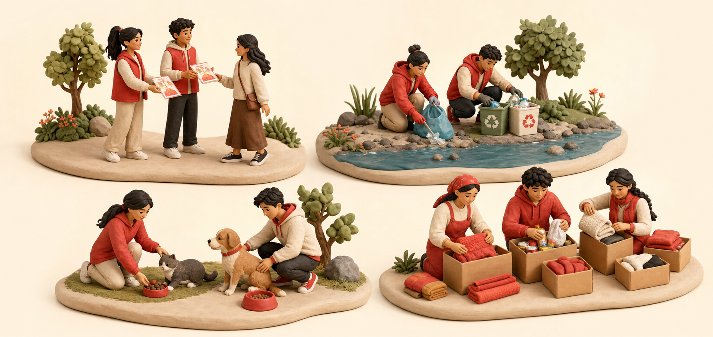
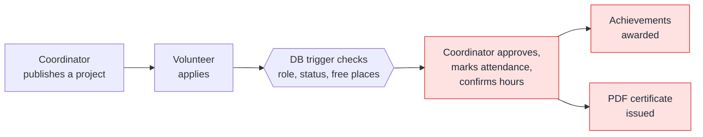

<div align="center">



<br>

<a href="https://qamqor-drab.vercel.app"></a>

<br><br>


<p>
  <a href="#features">Features</a> ·
  <a href="#how-it-works">How it works</a> ·
  <a href="#security">Security</a> ·
  <a href="#getting-started">Getting started</a> ·
  <a href="#project-structure">Structure</a>
</p>

</div>

## About

**Qamqor** (Kazakh for *care*) connects volunteers with the people who run social projects in Almaty, Astana and Shymkent.

Volunteers find a project, apply and build a verified record of their help: confirmed hours, achievements and PDF certificates. Coordinators publish projects and manage their applicants. Administrators look after roles and accounts. The landing page, project catalog and sign-in are available in **Russian, Kazakh and English**.



## Features

<table>
<thead>
<tr>
<th width="33%" align="left">For volunteers</th>
<th width="33%" align="left">For coordinators</th>
<th width="33%" align="left">For administrators</th>
</tr>
</thead>
<tbody>
<tr valign="top">
<td>

- Project catalog with search, filters, sorting and pagination
- One application per project, with live status tracking
- Active and completed project history
- Confirmed hours, achievements and PDF certificates
- Public profile that never exposes private fields

</td>
<td>

- Create, publish, edit and delete projects
- Cover upload with a branded fallback illustration
- Pick what volunteers receive: letters, hours, meals, transport, merch
- Review applicants, mark attendance, confirm actual hours
- WhatsApp group link visible only to applicants
- Project and applicant statistics with charts

</td>
<td>

- Promote volunteers to coordinators and remove the role
- Inherit every coordinator permission
- Delete volunteer accounts
- The admin role can never be chosen at sign-up or granted from the UI

</td>
</tr>
</tbody>
</table>

## How it works

Most of the rules live in PostgreSQL itself, so they hold no matter which client talks to the database.



- **Sign-up** creates a volunteer or coordinator profile through a trigger. Any other requested role falls back to volunteer.
- **Applications** are validated before insert: only volunteers can apply, the project must be published and still running, and it must have free places.
- **Confirmed hours** are summed per volunteer. Every achievement whose threshold is reached is awarded, and a certificate is issued for the project.
- **Certificates** are generated on request as PDFs with `pdf-lib`, with Noto Sans embedded so Cyrillic renders correctly.

## Security

- **Row Level Security** on every table: roles and ownership are enforced by the database, not only by the UI.
- **Server-side role checks** for administrator actions such as promoting coordinators or deleting accounts.
- **Privacy-safe public profiles**: public views expose only non-private fields.
- **Storage policies** isolate avatar and project-cover uploads by owner.
- **No secrets in the browser**: the app uses only the public Supabase key. The `service_role` key is needed only by the optional local smoke test.

## Tech stack

| Layer | Tools |
| --- | --- |
| Frontend | Next.js 15 (App Router, Turbopack), React 19, TypeScript, Tailwind CSS 4, Radix UI |
| Forms and validation | React Hook Form, Zod |
| Backend | Supabase Auth, PostgreSQL, Storage, Row Level Security, 14 SQL migrations |
| Charts and documents | Recharts, pdf-lib |
| Hosting | Vercel |

## Getting started

**Requirements:** Node.js 20+, npm, a Supabase project and the [Supabase CLI](https://supabase.com/docs/guides/cli).

```bash
# 1. Install dependencies
npm install

# 2. Create your local environment file and add your Supabase URL and anon key
cp .env.example .env.local

# 3. Apply migrations and seed data
supabase link --project-ref YOUR_PROJECT_REF
supabase db push --include-seed

# 4. Start the dev server
npm run dev
```

Then open [localhost:3000](http://localhost:3000).

| Variable | Required | Description |
| --- | :---: | --- |
| `NEXT_PUBLIC_SUPABASE_URL` | Yes | Supabase project URL |
| `NEXT_PUBLIC_SUPABASE_ANON_KEY` | Yes | Browser-safe publishable (anon) key |
| `NEXT_PUBLIC_APP_URL` | Recommended | Public URL of the app |

### Scripts

| Command | What it does |
| --- | --- |
| `npm run dev` | Start the dev server with Turbopack |
| `npm run build` | Production build |
| `npm run typecheck` | TypeScript check |
| `npm run lint` | ESLint with zero warnings allowed |
| `npm run test:supabase` | End-to-end smoke test of the RLS workflow on temporary users (needs `SUPABASE_SERVICE_ROLE_KEY`) |

### Deployment

Connect the repository to Vercel, add the three public environment variables and deploy `main`. In Supabase Auth, add the production and preview domains to the allowed redirect URLs.

## Project structure

```text
src/
├── app/            Route groups: (marketing), (auth), (app), plus the certificate API
├── components/     UI kit, forms, dashboards, project views, landing page
├── lib/            Server actions, Supabase clients, queries, i18n, PDF certificates
└── types/          Database and domain types
supabase/
├── migrations/     Schema, RLS policies, triggers
├── seed.sql        Reference achievements
└── templates/      Branded confirmation email
scripts/            Supabase smoke test, certificate preview
```

<details>
<summary><b>Database tables</b></summary>

<br>

`profiles` · `projects` · `project_applications` · `volunteer_hours` · `achievements` · `volunteer_achievements` · `certificates`

</details>

---

<div align="center">
<sub>Built by <a href="https://github.com/YelzhasTem">Yelzhas</a>. Certificates embed Noto Sans under the <a href="src/assets/fonts/OFL.txt">SIL Open Font License</a>.</sub>
</div>
